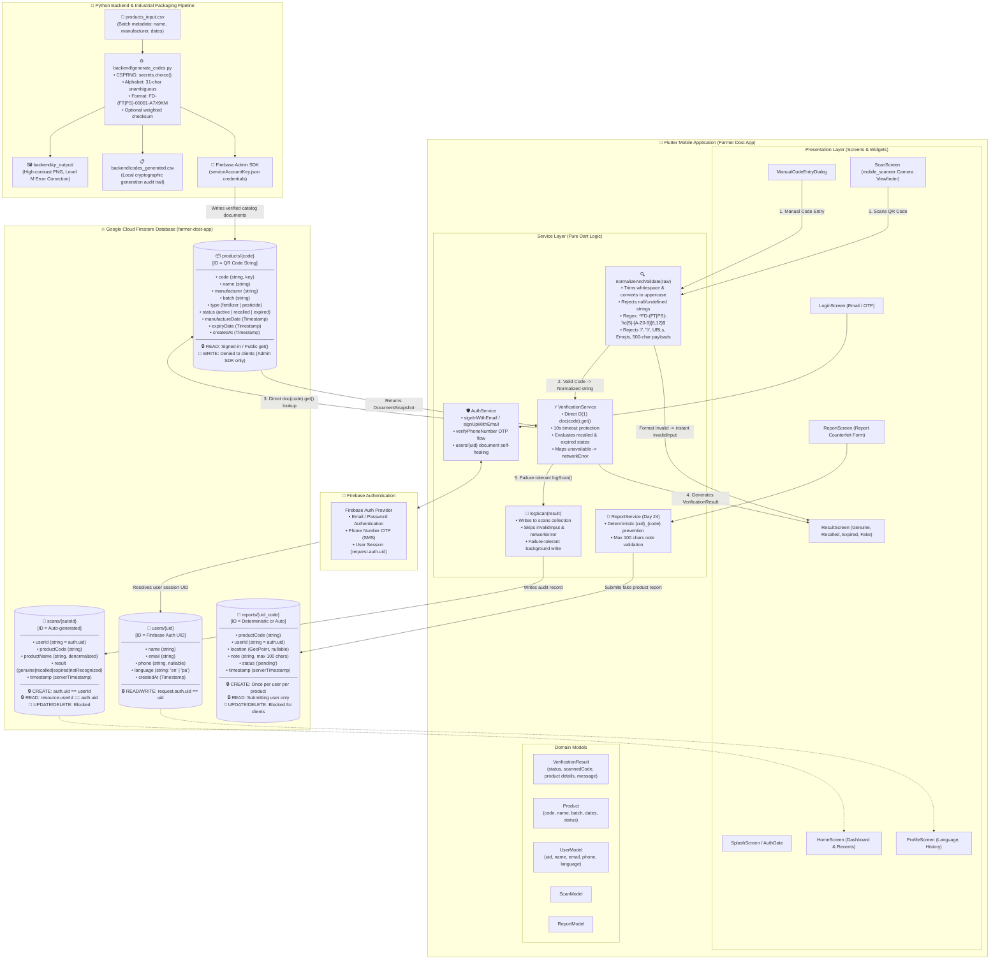

# Day 21 — Farmer Dost App System Architecture Diagram

> **System Architecture Specification**  
> Covers Flutter Mobile Client, Firebase Authentication, Cloud Firestore Collections, and Python Backend QR Generator.

---

## 1. High-Level Mermaid Architecture Diagram

---

## 2. Key Architectural Guarantees

1. **Client Isolation**: The Flutter app **never** has write permissions to `/products`. Product insertion occurs exclusively through the Python backend utilizing `serviceAccountKey.json`.
2. **Pre-Firestore Rejection**: All scanned strings are sanitized by `normalizeAndValidate()` before hitting network sockets. URLs, empty strings, illegal `/` paths, and garbage inputs cost 0 billable Firestore operations and execute in $< 1\text{ms}$.
3. **Deterministic Identity**:
   - `products`: Keyed by normalized uppercase QR string (`FD-FT-00123-A7X9KM`).
   - `users`: Keyed by Firebase Auth UID.
   - `reports`: Keyed deterministically by `{uid}_{productCode}` to prevent duplicate reporting spam.
   - `scans`: Auto-generated IDs representing an append-only audit log.
4. **Resilience & Rural Tolerance**: Every network call is guarded by a 10-second timeout. `logScan()` execution is fully decoupled so logging failures never delay displaying authenticity verdicts to farmers.
